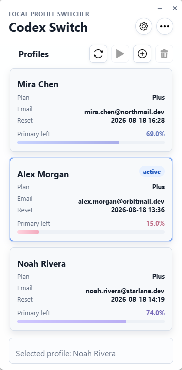
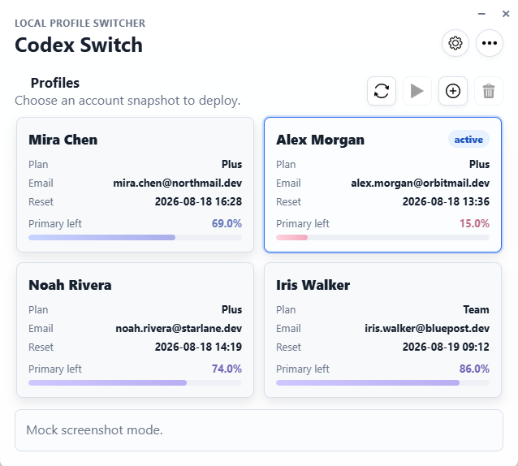

# Codex Switch

English | [中文](README.zh-CN.md)

A lightweight desktop app for switching local Codex / ChatGPT login snapshots. Windows is the existing supported platform; macOS 14+ is being ported and validated for Apple Silicon and Intel.

See the [app development guide](codex-switch-app/README.md) for shared architecture, synchronized versions, CI, and macOS acceptance checks.

Codex Switch stores separate local copies of your `.codex/auth.json` and `.codex/config.toml`, then lets you quickly switch between them. It is designed for users who regularly move between multiple Codex-capable accounts and want a small local tool rather than a proxy gateway.

## Features

- Save the current Codex login files as a named profile
- Switch to a selected profile by restoring its local `auth.json` and `config.toml`
- Login-new-profile flow that clears the current local login files, opens ChatGPT/Codex, waits for login files to become stable, then saves the new profile automatically
- Delete profiles by moving them to local trash instead of permanently deleting them
- View raw `auth.json` and `config.toml` contents
- Refresh usage information for saved profiles
- Start ChatGPT/Codex through Windows StartApps / AppsFolder discovery
- Hard kill ChatGPT/Codex process groups before switching
- Tray icon with profile switching and show/hide support

## Screenshots

Three profiles:



Four profiles:



## Download

For normal users, download the latest Windows installer from GitHub Releases:

```text
Codex Switch_0.2.1_x64-setup.exe
```

The portable executable is also available after building:

```text
codex-switch-app.exe
```

## Data Safety

This app manages files that may contain active login credentials.

Never upload or share your local data directory:

```text
codex_switch_data/
```

Never share these files:

```text
auth.json
config.toml
```

The included `.gitignore` excludes local profile data, build outputs, and temporary files.

## How It Works

Codex Switch uses the local Codex config directory:

```text
%USERPROFILE%\.codex
```

If `CODEX_HOME` is set, it uses that location instead.

For each profile, the app stores a local snapshot of:

```text
auth.json
config.toml
```

When switching, it:

1. Saves the current active files back to the active profile
2. Stops ChatGPT/Codex processes
3. Backs up the current `.codex` files
4. Restores the selected profile files
5. Starts ChatGPT/Codex again

For new logins, it clears the current local login files, starts ChatGPT/Codex, waits until `auth.json` and `config.toml` are present and stable, then saves the new profile using account information parsed from `auth.json`.

## Usage Query

The usage refresh feature reads the selected profile's local `auth.json` and requests usage data from:

```text
https://chatgpt.com/backend-api/wham/usage
```

This is not a public stable API. If OpenAI changes the endpoint or response format, usage display may stop working while profile switching continues to work.

## Development

Requirements:

- Windows
- Node.js
- Rust toolchain
- WebView2 Runtime

Run the app in development mode:

```powershell
cd codex-switch-app
npm install
npm run tauri dev
```

Build the app:

```powershell
npm run build
```

Build outputs:

```text
codex-switch-app/src-tauri/target/release/codex-switch-app.exe
codex-switch-app/src-tauri/target/release/bundle/nsis/Codex Switch_0.2.1_x64-setup.exe
```

If build fails because the exe is locked, exit Codex Switch from the tray and build again.

## Repository Layout

```text
codex-switch-app/
  src/
    index.html
    styles.css
    app.js
    assets/
  src-tauri/
    src/
      main.rs
      lib.rs
    tauri.conf.json
```

Legacy prototype files may exist locally during development, but the public release should mainly use `codex-switch-app/`.

## License

MIT
